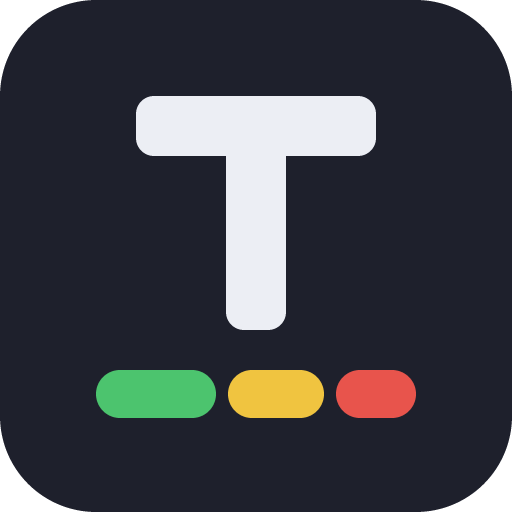

# Tokenomics

**Version 0.7.0** · MIT license · [Wiki](https://github.com/Rheinwolf/tokenomics/wiki) · [Changelog](CHANGELOG.md) · [Security](SECURITY.md) · [Contributing](CONTRIBUTING.md) · [Accessibility](ACCESSIBILITY.md)

*Token + economics:* a calm, readable bar above the prompt in Claude Code (desktop app and terminal) that shows what the current session costs and how much of your limits it uses:

```
Tokenomics 0.7.0  ·  1h30m  ·  API value this session: $4.37 · covered by subscription  ·  5h limit 41% · resets in 1h59m  ·  7d limit 17% · resets in 3d11h  ·  context 38%  ·  Opus 5.5  ·  LottoLabor · main ✗
```

<!-- Screenshot: docs/screenshot.png -->

## What it shows

| Segment | Example | Source |
|---|---|---|
| Cost / API value | `API cost this session: $4.37` | `$.session.usage().cost` |
| 5-hour limit + reset | `5h limit 41% · resets in 1h59m` | `rateLimits` (subscription only) |
| 7-day limit + reset | `7d limit 17% · resets in 3d11h` | `rateLimits` (subscription only) |
| Context fill | `context 38%` | `context.percent` |
| Model | `Opus 5.5` | `$.session.model()` |
| Project · branch · uncommitted | `LottoLabor · main ✗` | project root + git |
| Lines | `+120 / −30 lines` | uncommitted git diff vs `HEAD`; per file in the [changes pane](#changes-pane) |
| Cost per line | `$0.02 / line` | session cost ÷ changed lines |
| Today | `today $12.40` | all sessions today on this computer, once there is more than one |
| Duration | `1h30m` | session start time |

Any value the app does not provide is simply left out. Nothing is guessed.

### Traffic light
Colour is never the only signal — a symbol is added too:

Limits (5h / 7d) and context use the same traffic light:

- up to 50 %: green
- up to 75 %: yellow + `△`
- above 75 %: red + `▲`

With a **cost warning** set in `/tokenomics-setup`, the cost uses the same signals: yellow `△` at the first amount, red `▲` at the second. A **limit notice** pops up once when a limit goes above 75 %.

## The cost figure

Claude Code always computes a session cost at API list prices — even on a subscription. Tokenomics detects the billing type itself:

- **Subscription** (detected because 5h/7d limit data is present):
  `API value this session: $4.37 · covered by subscription`
  This is what the session *would* cost at API prices. It is not billed, your plan price is **not** subtracted, and it covers this session only. So it is not a "saving".
- **API billing:** `API cost this session: $4.37`
  A client-side estimate. Your invoice is the final authority.
- A trailing `*` means a model with no known price was counted at another model's rates.

Type `/tokenomics-explain` for this explanation inside the app.

## Install

### Which way is right for you?

| You use Claude Code … | Install this way |
|---|---|
| only in the **Claude desktop app** (Code tab) | [A: desktop app](#a-desktop-app) |
| in a **terminal** (the `claude` command) | [B: terminal](#b-terminal), choose the **user** scope |
| in **both** | B with the **user** scope covers both, or A in the app |
| for a **team project**, so everyone in the repository gets it | [B](#b-terminal) with the **project** scope |
| to **work on Tokenomics itself** | [C: development](#c-development) |

### A: Desktop app

The desktop app has no `/plugin` command and needs no terminal:

1. Click **+** next to the prompt box.
2. Choose **Plugins** → **Add marketplace** and enter `Rheinwolf/tokenomics`.
3. Click **Install** (or **Add plugin**) next to `tokenomics-bar`.
4. Type `/tokenomics-setup` to choose what the bar shows.

### B: Terminal

This needs the Claude Code command-line tool, i.e. the `claude` command. If your terminal says *"claude" is not recognized* (or *command not found*), it is not installed: either use [A](#a-desktop-app), or install it first following [Anthropic's setup guide](https://code.claude.com/docs/en/setup).

Inside a Claude Code session in the terminal:

```
/plugin install tokenomics-bar --marketplace Rheinwolf/tokenomics
```

or straight from the shell (PowerShell, bash, zsh):

```
claude plugin install tokenomics-bar --marketplace Rheinwolf/tokenomics
```

Answer `y` to add the marketplace, then choose a scope:

| Scope | Where the bar is active | Good for |
|---|---|---|
| **User** (recommended) | every session and every project on this computer, in the terminal and in the desktop app's Code tab | yourself |
| **Project** | only in this project, for everyone who uses the repository (saved in the project's settings) | teams |
| **Local** | only in this project, only for you | trying it out in one project |

### C: Development

To run Tokenomics from a folder while you change it, see [CONTRIBUTING.md](CONTRIBUTING.md):

```
claude --plugin-dir /path/to/tokenomics
```

### After installing

- Your setup choices (language, which items show, currency) are saved once and apply in every session and project.
- You can switch Tokenomics off any time in Claude Code's plugin management, also for single projects.
- Updates arrive through the plugin management. The bar always starts with its version, `Tokenomics x.y.z`.

## Setup

After installing, type:

```
/tokenomics-setup
```

A short guided setup opens in Claude's own question dialog and asks, one step at a time:

0. **Language**: English is always offered, plus the language detected from your recent messages. You can also type any language, in English or in your own language ("German" or "Deutsch"). Setup texts are available in English, Deutsch, Français, Español, Italiano, Polski, Nederlands and Português; other languages fall back to English.
1. **One question per item, each with a short explanation**, answered with *Yes* or *No*:
   - usage limits (5h / 7d)
   - reset times (`resets in 1h59m`)
   - context fill
   - model
   - project + git branch
   - changed lines (`+120 / −30 lines`), only asked if project + git is *Yes*
   - cost per changed line (`$0.02 / line`), only asked if changed lines is *Yes*
   - today's total (`today $12.40`), all sessions today on this computer
   - session time

   The cost figure always shows.
2. **Cost warning**: the cost turns yellow `△` and red `▲` at two amounts in USD. Suggested `$10 / $25`, *No warning*, or type your own (e.g. `5/20`).
3. **Limit notice**: a short notice when a 5h or 7d limit goes above 75 %, once per limit and reset period. Only asked if limits are shown.
4. **Second currency** (optional): e.g. EUR, GBP, CHF or any code you type
5. **Rate** for that currency: either a **fixed rate** you type (e.g. `0.92`), or, opt-in, the **daily reference rate of the European Central Bank** (one request per day to ecb.europa.eu, see [Privacy](#privacy)). The rate or `ECB <date>` is shown next to the converted value.

Your choices are saved and apply to every session. Until you run the setup, everything is visible and only USD is shown.

### Commands

| Command | What it does |
|---|---|
| `/tokenomics-setup` | guided setup (also `/tokenomics setup`) |
| `/tokenomics` | quick switch: compact (cost, limits, context) ↔ your own selection |
| `/tokenomics compact` · `full` | jump to compact or back to your selection |
| `/tokenomics-explain` | explain the cost figure |
| `/tokenomics-changes` | open or close the [changes pane](#changes-pane) |
| `/tokenomics-reset` | back to defaults (keeps your setup language) |

### Changes pane

`/tokenomics-changes` opens a pane beside the chat that lists every file changed since the last commit, with added and removed lines per file, new files marked `new`, and the total at the top. It updates after every turn and remembers whether it was open. Run the command again to close it.

## Privacy

**Tokenomics sends nothing about you anywhere** and has no telemetry. By default it makes **no network requests at all**; everything stays on your computer.

The one exception is **opt-in**: if you choose *Daily ECB rate* in `/tokenomics-setup`, Tokenomics downloads the European Central Bank's public reference rates once per day from `https://www.ecb.europa.eu/stats/eurofxref/eurofxref-daily.xml`. It is a plain download of a public file: no account, no key, no data about you in the request (the ECB's server sees your IP address, as with any website). The result is cached for the day in Claude Code's local plugin store. With a fixed rate or USD only, no request is ever made. If a value is missing or a call fails, that segment is hidden and the app is never disturbed.

### What it reads

| Data | Why | How |
|---|---|---|
| Session cost, 5h/7d limits, context fill, start time | the bar's figures | `$.session.usage()`, local to Claude Code |
| Model name | the model segment | `$.session.model()` |
| Project folder | its name for the project segment | `$.session.root()` |
| Git branch and uncommitted changes | the `project · branch ✗` segment and `+/− lines` | three read-only git commands run locally in the project folder: `git rev-parse --abbrev-ref HEAD`, `git status --porcelain`, `git diff --numstat HEAD` |
| Your last chat messages (text only) | **only during `/tokenomics-setup`**, to guess your language for the pre-selected option; counted locally, never stored or sent | `$.session.messages()` |

### Programs it runs

Tokenomics starts exactly one program: **`git`**, and only these three read-only commands, written as fixed text in `hooks/register.ts` (function `refreshRepo`):

| Command | Why |
|---|---|
| `git rev-parse --abbrev-ref HEAD` | the name of the current branch (e.g. `main`) |
| `git status --porcelain` | whether there are uncommitted changes (the `✗`) |
| `git diff --numstat HEAD` | how many lines were added and removed, per file (`+120 / −30 lines` and the changes pane) |

- They run in the project folder of the current session, at session start and after each turn, with a 5-second timeout.
- They only read. They change nothing, contact no server (no `fetch`, `pull` or `push`) and their output is used only to draw the bar.
- If git is not installed or the folder is not a git repository, the project segment simply shows the folder name.
- To avoid them completely, answer *No* to **project + git** in `/tokenomics-setup` and keep the changes pane closed.

### What it stores

Only your setup choices (language, which items show, compact switch, cost warning, limit notice, currency and rate, whether the changes pane is open), today's session costs for the daily total (one number per session, replaced the next day), which limit periods were already announced, and, if you opted in, the day's ECB rate for your currency, in Claude Code's local plugin store (`$.store`).

### What each hook does

| Hook | What it does |
|---|---|
| `session.start` | registers the five `/tokenomics…` commands, loads your saved setup, reads the git info, fetches the daily ECB rate if you opted in, reopens the changes pane if it was open |
| `command.run` | answers the five `/tokenomics…` commands only; it does not touch any other command |
| `session.measure` | redraws the bar when cost, limits or context change |
| `turn.complete` | refreshes the git info (and, if opted in, the day's ECB rate) after each turn and redraws the bar |
| `ui.render` (`AbovePrompt`) | draws the bar above the prompt |
| `ui.render` (`Pane`) | draws the changes pane (`/tokenomics-changes`) |

Tokenomics uses no other plugin and calls nothing outside Claude Code's own plugin interface.

Found a security problem? Please report it privately, see [SECURITY.md](SECURITY.md).

## Development

```
node --test "test/*.test.ts"
```

runs every check in `test/` with Node's built-in test runner: the formatter against sample data (subscription, API billing, missing values, Windows paths), edge cases (broken git output, NaN and negative values, limits above 100 %, Unicode names, incomplete ECB data), the translations, a syntax check and the version check. GitHub Actions runs the same on Ubuntu, Windows and macOS for every push and pull request.

## Contributing

Bug reports, ideas and translations are welcome: see [CONTRIBUTING.md](CONTRIBUTING.md) and the [Code of Conduct](CODE_OF_CONDUCT.md). How Tokenomics handles colour vision deficiency and other needs is described in [ACCESSIBILITY.md](ACCESSIBILITY.md).

## License

MIT, see [LICENSE](LICENSE).
